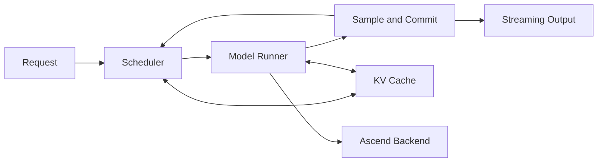

# mini-DeepInfer

**Understand DeepSeek inference. Build it on Ascend 910C.**

A readable inference engine, built step by step for learning and experimentation.

  

[简体中文](README.md) · **English**

[Architecture](docs/ARCHITECTURE.md) · [Roadmap](docs/ROADMAP.md) · [Validation](docs/VALIDATION.md) · [Contributing](CONTRIBUTING.md)

mini-DeepInfer is an educational inference engine under development for **Ascend 910C**, inspired by [DeepInfer](https://github.com/deepseek-ai/DeepInfer). The goal is to make inference understandable through code, diagrams, and experiments: from the first generated token to KV caches, continuous batching, MLA, and MoE.

Following the learning approach of [mini-sglang](https://github.com/sgl-project/mini-sglang), we aim to make the core execution path small enough to follow from request to output, then extend it one optimization at a time and measure the effect on latency, throughput, and memory.

> **Status: design and documentation.** Architecture, roadmap, and validation plans are available now. Engine implementation and Ascend 910C hardware validation will follow the milestones.

## From a forward pass to an inference engine

Generating text is the starting point. Serving requests of different lengths adds a new set of decisions: what to compute next, where to keep cached states, and when to return results while the device continues working.

mini-DeepInfer aims to make those decisions visible in the implementation:

- **Follow the request.** Trace scheduling, cache management, model execution, and output handling through a clear execution loop.
- **Explore DeepSeek architectures.** Progress from basic generation to MLA and MoE, then study selected DeepInfer mechanisms.
- **Learn Ascend execution.** Understand how `torch_npu`, fused operators, streams, events, and graph execution affect a real workload.

Every step follows the same sequence: **understand the computation → verify correctness → introduce an optimization → measure the change.**

## Planned mechanisms

| Topic | From concept to implementation |
| --- | --- |
| **Autoregressive generation** | Weight loading, prefill, token-by-token decode, sampling, and stopping conditions |
| **KV caches** | Contiguous and paged storage, position mapping, allocation, reclamation, and request isolation |
| **Batching and scheduling** | Continuous batching, chunked prefill, token budgets, and request lifecycles |
| **DeepSeek architectures** | MLA compressed caches, MoE routing, expert execution, and output combination |
| **Execution and advanced optimization** | Graph execution, scheduling overlap, single-node parallelism, and focused speculative decoding and bounded replay labs |

The design keeps reference and optimized paths available side by side, so readers can understand the math and compare the effect of a fused operator or execution strategy. Scope and completion criteria are in the [roadmap](docs/ROADMAP.md).

## One request through the system

This is the target execution structure. The scheduler selects the tokens for a step, the runner executes the model, and committed results advance the next step.

Start with synchronous execution, then add paged caches, changing batch membership, and scheduling overlap. Each step retains a reference for explaining and checking its behavior. See the [architecture](docs/ARCHITECTURE.md) for the design boundaries.

## From small models to DeepSeek

The learning path has three stages, each with a specific role:

1. **Generate the first token.** Use DeepSeek-R1-Distill-Qwen-1.5B and its Qwen architecture to implement real weight loading, a KV cache, and the generation loop.
2. **Explore MLA and MoE.** Use DeepSeek-V2-Lite / V2-Lite-Chat to study compressed caches and expert routing, with numerical checks against the corresponding model.
3. **Study DeepInfer mechanisms.** Build focused experiments for scheduling overlap, speculative state commit/rollback, and SWA bounded replay, tied to a pinned upstream revision.

Each lesson will identify its model and architectural assumptions. Full V4.1 deployment is a later research milestone. Model choices and deliverables are described in the [roadmap](docs/ROADMAP.md).

## Start here

If you know basic PyTorch and want to understand inference systems, start by following a single execution step:

| Read | What you will find |
| --- | --- |
| [Architecture](docs/ARCHITECTURE.md) | How requests, the scheduler, the runner, and caches fit together |
| [Validation](docs/VALIDATION.md) | How to compare logits, catch cache errors, and measure TTFT, TPOT, and throughput |
| [Roadmap](docs/ROADMAP.md) | Deliverables from single-request generation to DeepSeek architectures |
| [References](docs/REFERENCES.md) | Connections to DeepInfer and mini-sglang, including simplifications and attribution |

Detailed design documents are currently in Chinese. The next deliverable is **Ascend 910C environment and basic operator validation**, followed by single-request generation and a minimal serving engine. Each milestone will include runnable examples, explanations, and validation records.

## Build and learn with us

Contribute a clearer diagram, a more readable implementation, or a reproducible Ascend experiment. Design discussions and documentation improvements are welcome too. See the [contribution guide](CONTRIBUTING.md).

Interested in following the build? **Star the repository to bookmark it and follow future code and lessons.**

## Acknowledgments and license

Thanks to [DeepInfer](https://github.com/deepseek-ai/DeepInfer), [mini-sglang](https://github.com/sgl-project/mini-sglang), and [SGLang](https://github.com/sgl-project/sglang) for their open work.

This is an independent community project, unaffiliated with DeepSeek, SGLang, or Huawei. Original code and documentation are licensed under [Apache-2.0](LICENSE). Models and third-party components retain their own licenses; see [References](docs/REFERENCES.md) for attribution.
