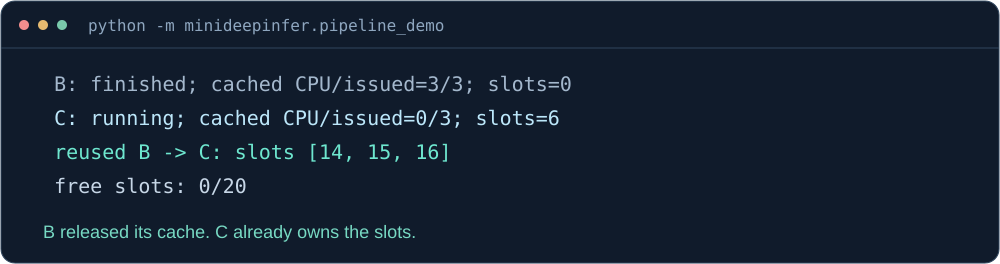

<div align="center">

# 

**Build a small inference engine for Ascend 910C.**

Study DeepInfer's execution design through runnable Qwen3.5 examples.

[](https://github.com/AkiYangDev/mini-deepinfer/actions/workflows/cpu.yml) [](docs/VALIDATION.md) [](pyproject.toml) [](LICENSE)

[简体中文](README.md) · **English**

[Quick start](#quick-start) · [Ascend 910C](#generate-text-on-ascend-910c) · [Speculative decoding](#speculative-decoding-and-sampling) · [Fourteen lessons](docs/LEARNING_PATH.md) · [DeepInfer source map](docs/SOURCE_MAP.md)

</div>


mini-DeepInfer is a small inference engine for **Ascend 910C**, built for learning and inspired by [DeepInfer](https://github.com/deepseek-ai/DeepInfer). Qwen3.5 forward passes, request scheduling, output commits and cache management are implemented here in Python and PyTorch, so you can follow a request through the code.

If you can already deploy a model and want to understand the engine behind it, start here. Follow how requests join a batch, how the next token is computed, and when memory can be reused by another request. The [fourteen lessons](docs/LEARNING_PATH.md) build up from a minimal loop to batching, chunked prefill and cross-round execution, with examples you can run and change.

Start on CPU with scheduling examples and random tiny models. On Ascend 910C, load real Qwen3.5 weights for single-model generation, or let 0.8B propose tokens for 2B to verify. The [round walkthrough](docs/MODEL_DRAFT_WALKTHROUGH.md#english-walkthrough) follows a wrong proposal through rollback and recovery of KV, convolution and recurrent state.

<br clear="both" />

## Quick start

Run this scheduling example with Python 3.10+ and its standard library. No dependencies or checkpoints are needed:

```bash
git clone https://github.com/AkiYangDev/mini-deepinfer.git
cd mini-deepinfer
python -m minideepinfer.step_demo
```

A is cancelled while the device still needs its cache. B changes batch rows but must retain its previous result. Manual completion events separate issued computation, committed output and cache release. Terminal explanations are in Chinese.

For a fixed learning version, use [v0.5.0](docs/RELEASE_v0.5.md#english-release-notes), which the [setup guide](docs/START_HERE.en.md) also follows. It includes dual-model text generation, streaming, cancellation, temperature and top-k/top-p sampling.

On main, [`generate --single`](docs/SINGLE_MODEL.md#english-quick-start) also supports sampling, streaming and cancellation with just one Qwen3.5 checkpoint. This entry point belongs to v0.6 development; use main to try it.

With PyTorch installed, run a randomly initialized tiny Qwen3.5 to see model execution join the scheduling loop:

```bash
python -m minideepinfer.pipeline_demo
```



B has just finished and C already holds its cache slots, so the free count is still zero. Meanwhile, A's long prompt is being processed in chunks. [Follow A, B and C through the code](docs/WALKTHROUGH.en.md) to connect each scheduling decision with a cache change, or read the [full terminal output](docs/assets/pipeline-demo.txt). The model is untrained; the example is about execution.

## Where to go next

| What you want to try | Start here |
| --- | --- |
| Explore scheduling and cache ownership on CPU | [Setup](docs/START_HERE.en.md) → [A/B/C walkthrough](docs/WALKTHROUGH.en.md) |
| Run your own prompt on Ascend 910C | [Environment and weights](docs/START_HERE.en.md) → [Text generation](#generate-text-on-ascend-910c) |
| Understand recovery after a wrong proposal | [Round walkthrough](docs/MODEL_DRAFT_WALKTHROUGH.md#english-walkthrough) → [Probability sampling](docs/SAMPLING.md#english-usage) |

The [lesson index](docs/LEARNING_PATH.md) lists the full sequence, commands and code locations in Chinese. English setup and the A/B/C walkthrough are also available.

<details>
<summary>Follow a rejected proposal and cache recovery on CPU</summary>

```bash
python -m minideepinfer.model_draft_demo --cpu-example rejection --trace-rounds --width 3 --output outputs/draft-rejection.json
```

The draft moves from six computed inputs back to four valid ones, then consumes the correction to reach five. The [round walkthrough](docs/MODEL_DRAFT_WALKTHROUGH.md#english-walkthrough) follows candidates, actual model inputs and committed output. No checkpoint or NPU is needed. Terminal labels are in Chinese; JSON fields are in English.

</details>

## Generate text on Ascend 910C

Real Qwen3.5-2B checkpoints have passed single-request, batch and cross-round generation checks. Prepare matching PyTorch, torch_npu and CANN versions and local weights using [setup](docs/START_HERE.en.md), then run from the repository directory. Multiline commands use Bash:

```bash
python -m minideepinfer.generate \
  --model weights/Qwen3.5-2B --device npu:0 --dtype float32 \
  --prompt "用两句话解释 KV Cache 的作用。" \
  --prompt "What is 1 plus 1? Answer in one short sentence." \
  --max-new-tokens 128 --cache-capacity 512 \
  --max-num-seqs 2 --max-batched-tokens 16 --chunked-prefill
```

The English answer from the real run:

```text
1 plus 1 equals 2.

[eos; 9 output tokens; free KV slots 512/512]
```

The [complete bilingual output](docs/results/2026-10-24/qwen35-2b-generation-npu-fp32.txt) is preserved. Add `--pipeline` for cross-round execution and `--stagger-prompts --trace-rounds` to follow arrivals and cache release. See the [text frontend](docs/PIPELINE_TEXT.md).

## Speculative decoding and sampling

Let Qwen3.5-0.8B propose and 2B verify. Accept a group and deliver several tokens together; reject it, discard temporary results, restore both caches and continue from the valid prefix. KV, convolution windows and recurrent state must all agree before the next forward pass.

Try your own prompt, watch the output stream, or request cancellation during generation. Complete commands are in the [text guide](docs/SPECULATIVE_TEXT.md#english-usage). To understand acceptance under random sampling, start with the [small-vocabulary experiment](docs/SAMPLING.md#english-usage), then examine probability and state-recovery checks on Ascend 910C. This reference path computes the model in NPU FP32 and probabilities in CPU FP64.

<details>
<summary>Stream output and cancel at a commit boundary</summary>

With local Qwen3.5-0.8B and 2B checkpoints:

```bash
python -m minideepinfer.generate \
  --model weights/Qwen3.5-2B --draft-model weights/Qwen3.5-0.8B \
  --speculative --device npu:0 --dtype float32 \
  --prompt "The capital of France is" --raw \
  --max-new-tokens 10 --cache-capacity 128 --draft-width 3 \
  --stream --cancel-after-tokens 2 --check-greedy \
  --output outputs/stream-cancel.json
```

The saved run stopped after delivering a whole group, with four committed tokens and all 14 slots returned in each pool. Cancellation does not truncate an accepted group. The greedy check covers only the delivered prefix, not the remaining output or EOS. Random sampling cannot use `--check-greedy`.

<p align="center"></p>

</details>

## Find the code behind a question

| Mechanism | Code and guide |
| --- | --- |
| One request: prefill, decode and output commits | [`Engine.step()`](minideepinfer/engine.py) · [lesson one](docs/FIRST_REQUEST.md) |
| Batching, token budgets and chunked prefill | [`BatchEngine`](minideepinfer/batch_engine.py) · [lesson three](docs/BATCHING.md) |
| KV, convolution windows and recurrent state | [`HybridCache`](minideepinfer/hybrid_cache.py) · [Qwen3.5](docs/QWEN35.md) |
| Continuing before the CPU reads the previous token | [`StoppingDecodePipeline`](minideepinfer/stopping_pipeline.py) · [cross-round chunks](docs/CHUNK_PIPELINE.md) |
| Recovering both caches after rejection | [`ModelDraft`](minideepinfer/model_draft.py) · [round walkthrough](docs/MODEL_DRAFT_WALKTHROUGH.md#english-walkthrough) |
| Acceptance and correction sampling | [`verify_sampled()`](minideepinfer/sampling.py) · [sampling experiments](docs/SAMPLING.md#english-usage) |

The [fourteen-lesson index](docs/LEARNING_PATH.md) provides the full sequence. The [DeepInfer source map](docs/SOURCE_MAP.md) records corresponding upstream code, retained mechanisms and teaching simplifications.

## Already running on Ascend 910C

| Saved record | What it checks |
| --- | --- |
| [Qwen3.5-2B on the NPU](docs/VALIDATION.md) | Ascend 910C FP32 model execution, single requests and batching |
| [Cross-round text](docs/PIPELINE_TEXT.md) | Matching sync, pipeline and staggered-arrival outputs; 43 full-logit comparisons pass |
| [Speculative sampling](docs/SAMPLING.md#english-usage) | 28 probability and six cold-state comparisons pass, including actual draft recovery after rejection |
| [Streamed cancellation](docs/SPECULATIVE_TEXT.md#english-usage) | Four delivered tokens match an independent greedy prefix; both pools release all slots |

The records preserve inputs, configuration, raw output and source hashes for [verification at the corresponding commit](docs/EVIDENCE.md). Performance experiments cover [sync versus pipeline](docs/PIPELINE_BENCHMARK.md#english-summary), [first commit](docs/FIRST_RESULT.md#english-summary) and [dual-model costs](docs/MODEL_DRAFT.md#english-summary), including short workloads that got slower. Accepting more tokens or making fewer forward calls does not always shorten a request; recovery, copies and waits also take time.

## Scope and sources

The main learning path uses one device, FP32, eager execution and short contexts. Greedy, temperature and top-k/top-p sampling, streaming and cancellation are implemented. See [BF16 notes](docs/BF16_REFERENCE.md) for reference checks and chunk-path differences. The earlier DeepSeek-R1-Distill-Qwen-1.5B example remains in regression checks. DeepSeek-V4.1 architecture, MLA/MoE, MTP, bounded replay, graphs and distributed execution are not yet implemented; see the [roadmap](docs/ROADMAP.md).

Engine design primarily follows [DeepInfer](https://github.com/deepseek-ai/DeepInfer). [mini-sglang](https://github.com/sgl-project/mini-sglang) informs the compact teaching format; Ascend SGLang informs NPU API work. [References and licenses](docs/REFERENCES.md) record the sources.

If the project helps you learn, please give it a Star. If a command fails or an explanation leaves you stuck, [open an issue](https://github.com/AkiYangDev/mini-deepinfer/issues/new/choose). To add an example or improve a lesson, start with the [contribution guide](CONTRIBUTING.md).

This independent community project has no official affiliation with DeepSeek, SGLang or Huawei. Original code and documentation use [Apache-2.0](LICENSE); models and third-party code retain their licenses. Character artwork is covered separately in the [artwork notes](docs/assets/ARTWORK.md).
