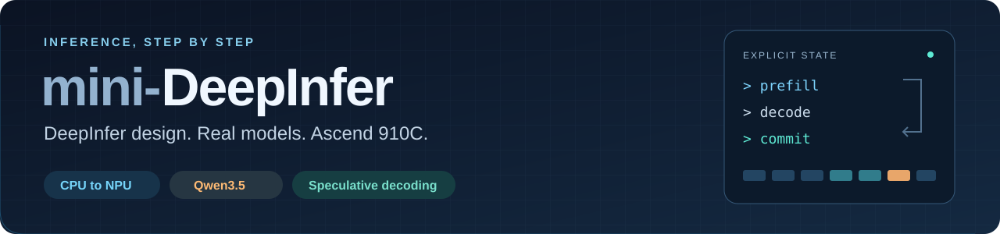

<div align="center">

# 

**用一个能运行的小引擎，学 DeepInfer 的执行设计。**

从 CPU 上的一条请求，走到 Ascend 910C 上的真实模型。

[](https://github.com/AkiYangDev/mini-deepinfer/actions/workflows/cpu.yml) [](docs/VALIDATION.md) [](pyproject.toml) [](LICENSE)

**简体中文** · [English](README.en.md)

[快速开始](#快速开始) · [Ascend 910C 实机](#在-ascend-910c-上生成文本) · [投机解码](#投机解码与随机采样) · [十四课](docs/LEARNING_PATH.md) · [DeepInfer 源码对应](docs/SOURCE_MAP.md)

</div>

读推理框架，难点往往在模型前向之外：请求什么时候进入批次，设备算出的 token 什么时候提交，缓存什么时候能交给下一条请求。mini-DeepInfer 参考 [DeepInfer](https://github.com/deepseek-ai/DeepInfer) 的执行设计，用 Python 和 PyTorch 把这些过程写成能运行、能跟踪的代码。

当前模型载体是 Qwen3.5。调度、模型 forward、KV 与线性状态、候选验证和回退都在仓库里；可以对着实际输出读代码。

## 快速开始

本页跟随 main（0.5.0.dev0），需 Python 3.10+。三条命令先看一条请求怎样执行，无需安装依赖或下载权重：

```bash
git clone https://github.com/AkiYangDev/mini-deepinfer.git
cd mini-deepinfer
python -m minideepinfer.step_demo
```

例子里 A 已取消，设备却还在使用它的缓存；B 换了批次行号，也必须接上自己的上一轮结果。手动事件把“发出计算、提交结果、归还缓存”分开打印出来。

**想跑真实 forward？** 已有 PyTorch 时，继续运行无需权重的随机 Qwen3.5 小模型：

```bash
python -m minideepinfer.pipeline_demo
```


B 已释放，空闲槽位为什么仍是 0？因为 C 已经接过了它们。A 的长 prompt 还在分块执行，三个请求的进度各不相同。[跟着 A、B、C 读代码](docs/WALKTHROUGH.md)，或查看[完整终端输出](docs/assets/pipeline-demo.txt)。随机模型用于观察执行过程，输出文本不代表回答能力。

## 选一条路线，动手学

| 你想先做什么 | 从这里开始 |
| --- | --- |
| 没有 NPU，先看调度和缓存 | [CPU 入门](docs/START_HERE.md) → [A/B/C 演示](docs/WALKTHROUGH.md) |
| 有 Ascend 910C，运行自己的问题 | [准备环境与权重](docs/START_HERE.md#ascend-910c真实权重) → [文本生成](#在-ascend-910c-上生成文本) |
| 看小模型猜错后怎样恢复 | [双模型逐轮演示](docs/MODEL_DRAFT_WALKTHROUGH.md) → [概率采样](docs/SAMPLING.md) |

三条路线都对应仓库里的实际实现。十四课从单请求走到动态批处理、分块 prefill、跨轮执行、到达与取消；[每课都有命令和代码位置](docs/LEARNING_PATH.md)。

<details>
<summary>先在 CPU 上看一次候选拒绝与缓存恢复</summary>

```bash
python -m minideepinfer.model_draft_demo --cpu-example rejection --trace-rounds --width 3 --output outputs/draft-rejection.json
```

draft 从“已算 6 个 → 保留 4 个 → 补到 5 个输入”接回正确前缀。[逐轮讲解](docs/MODEL_DRAFT_WALKTHROUGH.md)对照候选、实际模型输入和最终提交；这个例子不需要权重或 NPU。

</details>

## 在 Ascend 910C 上生成文本

Qwen3.5-2B 已通过真实权重的单请求、批处理与跨轮生成检查。先按[运行指南](docs/START_HERE.md#ascend-910c真实权重)准备匹配的 PyTorch、torch_npu、CANN 和本地权重，再从仓库目录运行。多行命令使用 Bash：

```bash
python -m minideepinfer.generate \
  --model weights/Qwen3.5-2B --device npu:0 --dtype float32 \
  --prompt "用两句话解释 KV Cache 的作用。" \
  --prompt "What is 1 plus 1? Answer in one short sentence." \
  --max-new-tokens 128 --cache-capacity 512 \
  --max-num-seqs 2 --max-batched-tokens 16 --chunked-prefill
```

真实运行中的英文回答：

```text
1 plus 1 equals 2.

[eos; 9 output tokens; free KV slots 512/512]
```

[完整双语输出](docs/results/2026-10-24/qwen35-2b-generation-npu-fp32.txt)已保存。添加 `--pipeline` 让文本走跨轮执行，再用 `--stagger-prompts --trace-rounds` 观察请求到达与缓存回收，见[文本接入说明](docs/PIPELINE_TEXT.md)。

## 投机解码与随机采样

Qwen3.5-0.8B 提候选，2B 验证。除了接受几个 token，更值得看的是猜错以后发生了什么：target 丢弃哪些临时结果，draft 怎样恢复线性状态，接下来又从哪个前缀继续。

main 支持自己的文本、逐组流式输出和提交后取消；[文本入口](docs/SPECULATIVE_TEXT.md)给出完整命令。正温度采样也复用同一循环，包含概率接受和拒绝后的补采样，[小词表实验](docs/SAMPLING.md)解释规则，Ascend 910C 记录验证数值与状态恢复。模型用 NPU FP32 计算，概率保留在 CPU FP64。

<details>
<summary>运行一次流式生成，在提交组边界取消</summary>

准备本地 Qwen3.5-0.8B 和 2B 权重后执行：

```bash
python -m minideepinfer.generate \
  --model weights/Qwen3.5-2B --draft-model weights/Qwen3.5-0.8B \
  --speculative --device npu:0 --dtype float32 \
  --prompt "The capital of France is" --raw \
  --max-new-tokens 10 --cache-capacity 128 --draft-width 3 \
  --stream --cancel-after-tokens 2 --check-greedy \
  --output outputs/stream-cancel.json
```

实机记录在完整交付下一组后停在 4 个 token，两边各归还 14 个槽位。取消门槛不会截断已经提交的接受组；greedy 检查只对照已交付前缀，不表示剩余输出或 EOS 已验证。随机采样不能同时使用 `--check-greedy`。

</details>

本页命令以 **main（0.5.0.dev0）** 为准。固定学习版本见 [v0.4.0](docs/RELEASE_v0.4.md)；自己的投机文本、流式取消与概率采样需要 main。

## 从问题找到代码

| 想读懂的机制 | 代码与教程 |
| --- | --- |
| 一次请求的 prefill、decode 与输出提交 | [`Engine.step()`](minideepinfer/engine.py) · [第一课](docs/FIRST_REQUEST.md) |
| 合批、token 预算与分块 prefill | [`BatchEngine`](minideepinfer/batch_engine.py) · [第三课](docs/BATCHING.md) |
| KV、卷积窗口与递推状态 | [`HybridCache`](minideepinfer/hybrid_cache.py) · [Qwen3.5 模型](docs/QWEN35.md) |
| CPU 尚未读到 token，下一轮怎样接着算 | [`StoppingDecodePipeline`](minideepinfer/stopping_pipeline.py) · [跨轮与分块](docs/CHUNK_PIPELINE.md) |
| 候选拒绝后，两份缓存怎样恢复 | [`ModelDraft`](minideepinfer/model_draft.py) · [双模型演示](docs/MODEL_DRAFT_WALKTHROUGH.md) |
| 概率接受与拒绝后的补采样 | [`verify_sampled()`](minideepinfer/sampling.py) · [采样实验](docs/SAMPLING.md) |

[十四课](docs/LEARNING_PATH.md)给出完整顺序；[DeepInfer 源码映射](docs/SOURCE_MAP.md)标明保留的机制、对应入口和教学简化。

## 结果可以复核

| 已有记录 | 验证了什么 |
| --- | --- |
| [Qwen3.5-2B 实机](docs/VALIDATION.md) | Ascend 910C FP32 的模型计算、单请求与批处理 |
| [跨轮文本](docs/PIPELINE_TEXT.md) | 同步、跨轮和逐条到达输出一致；43 组完整 logits 对照通过 |
| [投机采样](docs/SAMPLING.md#ascend-910c验证概率和回退) | 28 组概率、6 组冷缓存对照通过，真实覆盖 draft 拒绝恢复 |
| [流式取消](docs/SPECULATIVE_TEXT.md#ascend-910c-检查) | 已交付的 4 个 token 匹配独立 greedy 前缀，两份缓存均归还 |

报告保存输入、配置、原始结果和源码 SHA；[历史结果按固定 commit 核对](docs/EVIDENCE.md)。[同步与跨轮](docs/PIPELINE_BENCHMARK.md)、[首轮提交](docs/FIRST_RESULT.md)和[双模型成本](docs/MODEL_DRAFT.md)也保留了短负载更慢的结果。接受率与减少的 forward 次数本身不能证明吞吐收益。

## 范围与来源

项目保持单设备、FP32、eager、短上下文的教学范围。greedy 和正温度投机采样已有实现；BF16 的参考检查与分块差异见[说明](docs/BF16_REFERENCE.md)，旧 DeepSeek-R1-Distill-Qwen-1.5B 示例继续回归。DeepSeek-V4.1 架构、MLA/MoE、MTP、bounded replay、图执行和分布式仍在[后续路线](docs/ROADMAP.md)中。

执行设计主要参考 [DeepInfer](https://github.com/deepseek-ai/DeepInfer)，[mini-sglang](https://github.com/sgl-project/mini-sglang)提供精简实现与教学组织参考，Ascend SGLang 提供 NPU 接口参考。[来源与许可证](docs/REFERENCES.md)逐项记录。

如果你也在学推理框架，欢迎 Star 留作代码阅读入口。跑不通的命令、没讲清的状态变化，欢迎直接[提 Issue](https://github.com/AkiYangDev/mini-deepinfer/issues/new/choose)；想一起补实现或教程，可以从[贡献指南](CONTRIBUTING.md)开始。

独立社区项目，与 DeepSeek、SGLang、华为无官方隶属关系。原创代码和文档采用 [Apache-2.0](LICENSE)，模型与第三方代码遵循各自许可证。
