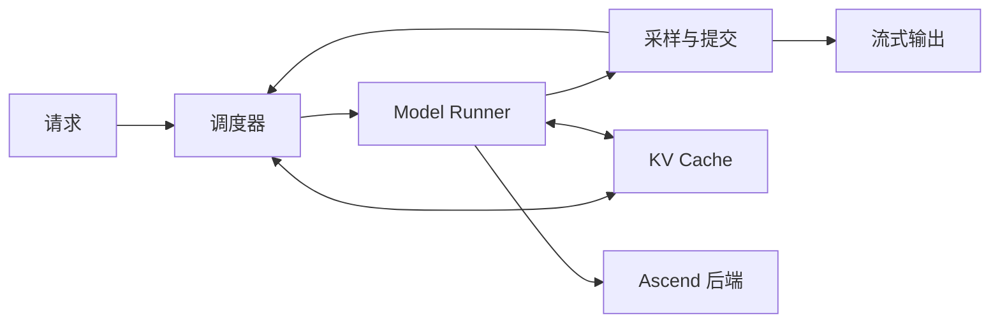

<div align="center">

# mini-DeepInfer

**在 Ascend 910C 上，从零读懂 DeepSeek 推理。**

Understand DeepSeek inference. Build it on Ascend 910C.

[](docs/ROADMAP.md) [](docs/FIRST_REQUEST.md) [](LICENSE)

**简体中文** · [English](README.en.md)

[架构设计](docs/ARCHITECTURE.md) · [开发路线](docs/ROADMAP.md) · [验证方法](docs/VALIDATION.md) · [参与贡献](CONTRIBUTING.md)

</div>

mini-DeepInfer 借鉴 [DeepInfer](https://github.com/deepseek-ai/DeepInfer) 的设计，面向 **Ascend 910C** 逐步构建一个可读的教学推理引擎。从第一个生成 token，到 KV Cache、连续批处理、MLA 和 MoE，用实现、图解和实验把推理系统的工作过程讲清楚。

我们参考 [mini-sglang](https://github.com/sgl-project/mini-sglang) 的教学思路，让读者能够沿着一次请求读完核心执行路径，再亲手加入一项优化，观察它怎样改变延迟、吞吐和显存占用。

**技术主线是 DeepInfer 的教学化拆解。** 引擎职责、执行元数据、结果提交与后续在途状态机制对照 DeepInfer 源码演进；mini-sglang 提供精简实现和教学组织的参考，Ascend SGLang 提供 NPU 接口与兼容性参考。当前骨架与原版的对应、简化和未实现部分见[源码映射](docs/SOURCE_MAP.md#deepinfer-主线与当前骨架)。

> **开发阶段：单请求模型实现。** 已接入 DeepSeek-R1-Distill-Qwen-1.5B 的独立 forward、张量 KV Cache 和离线生成，真实权重 CPU 数值对照通过。Ascend 910C 上的完整模型验证待补。整数 Runner 继续用于第一课，真实模型的运行方法见[第二课](docs/REAL_GENERATION.md)。

## 先跑一个请求

Python 3.10+，演示与测试只使用标准库，无需下载权重：

```bash
git clone https://github.com/AkiYangDev/mini-deepinfer.git
cd mini-deepinfer
python -m minideepinfer
python -m unittest discover -s tests -v
```

你会看到两个请求依次执行：

```text
req-0 prefill input=(10, 11) positions=(0, 1) write_slots=(0, 1)
  -> token=12, cached_inputs=2, stop=-
req-0 decode  input=(12,) positions=(2,) write_slots=(2,)
  -> token=13, cached_inputs=3, stop=-
req-0 decode  input=(13,) positions=(3,) write_slots=(3,)
  -> token=14, cached_inputs=4, stop=length
...
Free slots: 8/8
```

为什么生成了 `14`，它却还没有写入 KV？下一轮请求为什么又能使用槽位 `0`？从[第一课：跟踪一个请求](docs/FIRST_REQUEST.md)开始，按 [`demo.py`](minideepinfer/demo.py) → [`Engine.step()`](minideepinfer/engine.py) → [`SlotPool`](minideepinfer/kv_cache.py) 的顺序读代码。

## 运行真实模型

在已有匹配的 PyTorch / `torch_npu` 环境中安装项目，准备好本地权重：

```bash
python -m pip install -e ".[model]"
python -m minideepinfer.generate \
  --model /path/to/DeepSeek-R1-Distill-Qwen-1.5B \
  --device npu:0 --dtype bfloat16 --max-new-tokens 32
```

模型使用基础运算实现 RMSNorm、RoPE、GQA attention 和 MLP，计算路径见 [`qwen2.py`](minideepinfer/models/qwen2.py)。[`ModelRunner`](minideepinfer/model_runner.py) 对照 DeepInfer 划分输入准备、forward 和采样，Engine 负责提交结果。Transformers 用于 tokenizer 与数值对照。

模型范围、依赖版本和 logits 验证命令见[第二课：真实权重与 KV Cache](docs/REAL_GENERATION.md)。目前适合短上下文教学运行，尚未实现动态批处理或调度重叠。

## 从一次 forward，到一个推理引擎

调用模型生成文本只是起点。当不同长度的请求不断到来，推理引擎需要决定下一批计算什么、为哪些 token 保留缓存，以及何时把设备计算的结果交还给用户。

mini-DeepInfer 的目标，是把这些决定展开成能读懂的代码：

- **沿着请求学系统。** 把调度、缓存、模型执行和结果提交串成一条清晰的路径。
- **沿着 DeepSeek 学架构。** 从基础生成走向 MLA、MoE，再拆解 DeepInfer 的进阶机制。
- **沿着 Ascend 学优化。** 理解 `torch_npu`、融合算子、stream/event 和图执行如何影响真实运行。

每一步都按同样的顺序展开：**读懂计算 → 验证正确性 → 加入优化 → 测量变化。**

## 计划覆盖的核心机制

| 主题 | 从原理走到实现 |
| --- | --- |
| **自回归生成** | 权重加载、prefill、逐 token decode、采样与停止条件 |
| **KV Cache** | 连续与分页存储、位置映射、分配回收，以及请求之间的隔离 |
| **批处理与调度** | Continuous batching、chunked prefill、token 预算和请求生命周期 |
| **DeepSeek 架构** | MLA 压缩缓存、MoE 路由、专家计算与结果合并 |
| **执行与进阶优化** | 图执行、调度重叠、单机并行，以及投机解码和 bounded replay 的独立实验 |

设计采用参考路径与优化路径并行保留的方式：既能看清数学计算，也能比较融合算子或执行策略带来的变化。具体范围与验收条件见[开发路线](docs/ROADMAP.md)。

## 一个请求，贯穿整个系统

下面是教学引擎的目标执行结构。调度器决定本轮处理哪些 token，Runner 组织模型计算，结果提交后再推进下一轮。



从同步执行开始，再逐步加入分页缓存、动态批次和调度重叠。每增加一层复杂度，都保留能解释结果的对照。详细边界见[架构设计](docs/ARCHITECTURE.md)。

## 从小模型，走向 DeepSeek

学习路线分为三个层级，各自承担不同任务：

1. **先生成第一个 token。** 使用 DeepSeek-R1-Distill-Qwen-1.5B，在 Qwen 架构上完成真实权重加载、KV Cache 与生成循环。
2. **再深入 MLA 与 MoE。** 使用 DeepSeek-V2-Lite / V2-Lite-Chat，将压缩缓存、专家路由和模型数值逐项对齐。
3. **进一步拆解 DeepInfer。** 对照固定版本源码，构造调度重叠、投机状态提交与回退、SWA bounded replay 的独立实验。

各章会标明对应模型与架构；完整 V4.1 部署作为后续研究里程碑。模型选择与阶段安排见[开发路线](docs/ROADMAP.md)。

## 从这里开始

如果你会写基础 PyTorch，想进一步理解大模型推理系统，可以先从一次执行步骤开始读：

| 阅读入口 | 你会得到什么 |
| --- | --- |
| [架构设计](docs/ARCHITECTURE.md) | 请求、调度器、Runner 和缓存如何协作 |
| [验证方法](docs/VALIDATION.md) | 如何比较 logits、排查缓存错误，并测量 TTFT、TPOT 与吞吐 |
| [开发路线](docs/ROADMAP.md) | 从单请求生成到 DeepSeek 架构的阶段交付 |
| [参考与来源](docs/REFERENCES.md) | 与 DeepInfer、mini-sglang 的对应关系及简化边界 |

接下来加入同步动态批处理，检查请求进入、结束和缓存复用时的行为，再做 DeepInfer 跨轮状态与调度重叠实验。各阶段都保留可运行示例和数值对照。

## 一起把推理讲明白

欢迎贡献一个清晰的图解、一段更容易读懂的实现，或一次能够复现的 Ascend 实验。设计讨论与文档改进也同样有价值，详见[贡献指南](CONTRIBUTING.md)。

如果你也想沿着这条路线学习，欢迎 **Star 收藏，关注后续代码与教程**。

## 致谢与许可证

感谢 [DeepInfer](https://github.com/deepseek-ai/DeepInfer)、[mini-sglang](https://github.com/sgl-project/mini-sglang) 和 [SGLang](https://github.com/sgl-project/sglang) 的开源工作。

本项目为独立社区项目，与 DeepSeek、SGLang 及华为无官方隶属关系。原创代码与文档采用 [Apache-2.0](LICENSE)，模型与第三方组件遵循各自许可证。详细归属见[参考与来源](docs/REFERENCES.md)。
