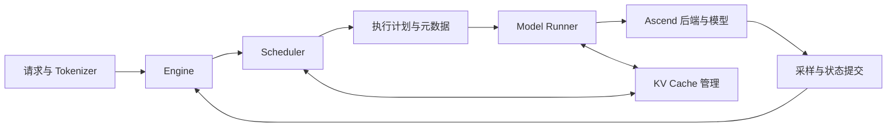

# mini-DeepInfer

**读懂推理，跑在昇腾。**

A readable inference engine for DeepSeek models on Ascend 910C.

[English](README.en.md) · [实施路线](docs/ROADMAP.md) · [架构设计](docs/ARCHITECTURE.md) · [验证方法](docs/VALIDATION.md)

mini-DeepInfer 面向学习者和推理系统开发者，目标是在 **Ascend 910C** 上，用清晰的 Python 实现串起大模型推理的完整过程：请求如何进入批次，KV Cache 如何分配，prefill 与 decode 如何执行，以及每一次优化为什么有效。

项目借鉴 [DeepInfer](https://github.com/deepseek-ai/DeepInfer) 的引擎设计，参考 [mini-sglang](https://github.com/sgl-project/mini-sglang) 的轻量实现与教学思路，将代码、原理和真实硬件实验放在一起。

> **当前阶段：项目设计与文档。** 推理引擎尚待实现；Ascend 910C 是目标平台，模型与算子支持以后续实测记录为准。

## 为什么做这个项目

模型决定能生成什么，推理系统决定这些结果怎样被高效地交付给用户。

从一次 `forward` 到持续接收请求的服务，中间还有调度、缓存、内存布局、异步执行与设备通信。mini-DeepInfer 希望让这些机制变得具体：找到对应代码，运行一个实验，观察结果，再亲手修改它。

## 项目方向

以下是计划建设的能力，进度与验收条件见[实施路线](docs/ROADMAP.md)。

| 方向 | 你将学到什么 |
| --- | --- |
| **Ascend 910C 适配** | `torch_npu`、设备内存、stream/event、融合算子与图执行如何组成执行后端 |
| **完整生成链路** | 从权重加载、prefill、KV Cache 到逐 token decode 和采样 |
| **服务与调度** | Continuous batching、分页 KV 管理、chunked prefill 和流式响应 |
| **DeepSeek 架构** | 从小模型起步，进一步理解 MLA、压缩缓存、MoE 路由与专家计算 |
| **DeepInfer 机制实验** | 将调度重叠、投机状态提交与回退、SWA bounded replay 拆成可验证的实验 |
| **可复现性能分析** | 在统一负载下比较正确性、TTFT、TPOT、吞吐与显存占用 |

每一项能力都沿着同一条学习路径展开：**读懂参考实现 → 检查正确性 → 加入优化 → 测量代价与收益。**

## 从小模型走向 DeepSeek

| 层级 | 计划使用的模型或实验 | 教学任务 |
| --- | --- | --- |
| 入门 | DeepSeek-R1-Distill-Qwen-1.5B | 跑通基于 Qwen 架构的真实权重加载与生成，理解基础执行循环 |
| 主线 | DeepSeek-V2-Lite / V2-Lite-Chat | 学习 MLA 与 MoE；与对应模型参考实现逐级对齐 |
| 进阶 | 来自固定版本 DeepInfer 的独立机制实验 | 理解异步调度、投机状态管理和模型相关缓存优化 |

蒸馏模型采用 Qwen 架构；V2-Lite 与 V4.1 也有架构差异。各章会说明适用模型与简化边界。完整 V4.1 部署作为后续研究方向单独评估。

## 一次推理步骤



调度器决定本轮处理哪些 token，执行器负责计算，缓存管理器维护存储与映射。明确这些边界后，才逐步加入图执行和调度重叠。上图是目标设计，详细约定见[架构文档](docs/ARCHITECTURE.md)。

## 开始阅读

```bash
git clone https://github.com/AkiYangDev/mini-deepinfer.git
cd mini-deepinfer
```

建议按以下顺序阅读：

1. [实施路线](docs/ROADMAP.md)：首版范围、阶段交付与完成条件。
2. [架构设计](docs/ARCHITECTURE.md)：一次执行步骤，以及请求、缓存与计算的边界。
3. [验证方法](docs/VALIDATION.md)：怎样判断输出正确、优化有效。
4. [参考与来源](docs/REFERENCES.md)：与 DeepInfer、mini-sglang 的对应关系。

安装、推理和服务命令将在对应实现通过验证后加入。

## 开发进度

| 里程碑 | 状态 |
| --- | --- |
| 项目定位、架构草案、实施与验证计划 | 已完成首稿 |
| M0：Ascend 910C 环境与算子验证 | 待开始 |
| M1：单请求真实生成 | 待开始 |
| M2：最小服务引擎 | 待开始 |
| M3：DeepSeek-V2-Lite 架构主线 | 待开始 |
| M4：Ascend 执行优化与单机并行 | 待开始 |
| M5：DeepInfer 进阶机制实验 | 待开始 |

## 参与贡献

欢迎贡献可复现的问题、算子验证、教学示例、代码和文档。每一项优化都应有明确的正确性检查和实验条件，详见[贡献指南](CONTRIBUTING.md)。

## 致谢与许可证

感谢 [DeepInfer](https://github.com/deepseek-ai/DeepInfer)、[mini-sglang](https://github.com/sgl-project/mini-sglang) 和 [SGLang](https://github.com/sgl-project/sglang) 提供设计与学习参考。

本项目由社区独立开发，与 DeepSeek、SGLang 及华为无官方隶属关系。项目原创代码与文档采用 [Apache-2.0](LICENSE)；模型权重及未来引入的第三方组件遵循各自许可证，来源记录见[参考文档](docs/REFERENCES.md)。
