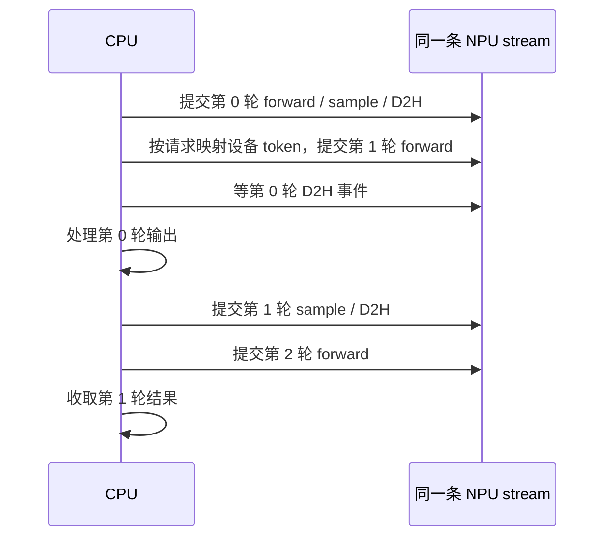

# 第十一课：CPU 还没读到 token，下一轮怎么开始？

[返回首页](../README.md) · [源码映射](SOURCE_MAP.md) · [验证记录](VALIDATION.md)

前面把计算发起和结果收取拆开了，但 BatchEngine 仍要读到上一轮 token，才能填写下一轮的 `Step.input_ids`。这条依赖没有改变：只要下一轮输入还从 CPU 取，结果处理就始终挡在 forward 前面。

这次增加一个独立的固定批次实验。两条请求各生成四个 token，成员和长度提前确定，不检查 EOS。上一轮采样结果留在设备上，下一轮按请求 ID 找回自己的那一行，直接作为模型输入。这样，CPU 可以先提交下一轮 forward，再读取上一轮结果。

代码在 [`decode_pipeline.py`](../minideepinfer/decode_pipeline.py)，不到 180 行。现有 BatchEngine 和默认生成入口保持原来的执行方式。

## DeepInfer 的顺序是什么

固定参考版本仍为 `8b161497`。它的 [`Worker.execute_model_step()`](https://github.com/deepseek-ai/DeepInfer/blob/8b16149741a4935e1dec8cea27853f273b374c5b/deepinfer/worker/worker.py) 明确分成四步：

1. 执行本轮主模型。
2. 等上一轮采样完成，处理上一轮结果。
3. 采样本轮结果。
4. prompt 或关闭 ZOS 时当轮处理结果；开启 ZOS 的 decode 留到下一轮。

因此，上一轮 token 并没有消失。它保存在设备上，经 [`MetadataZOS`](https://github.com/deepseek-ai/DeepInfer/blob/8b16149741a4935e1dec8cea27853f273b374c5b/deepinfer/worker/zos_status.py) 传给本轮输入准备。`remap[i] = j` 表示本轮第 i 行对应上一轮第 j 行；前后批次成员不完全相同时，还要区别新请求和已有请求，并处理长度修正。

本课只保留最基本的设备 token 接续和 forward / post-process / sample 顺序。没有接入上游 C++ 调度器、MTP、长度修正、图执行或资源池；实验也将首轮 prefill 的结果延后到下一轮收取，这一点与原版 prompt 当轮处理不同。

## 用两条请求走一遍

假设上一轮行顺序是 `[A, B]`，设备采样结果是 `[11751, 369]`。下一轮变成 `[B, A]`，映射就是 `[1, 0]`：

```python
rows = torch.tensor([1, 0], dtype=torch.long, device=device)
device_input_ids = previous.tokens.index_select(0, rows)
# 得到 [369, 11751]，不需要先把两个 token 读回 CPU。
```

本次真实 2B 检查的首轮恰好产生了这两个 token。行号由 CPU 已知的请求 ID 计算，token 值来自设备上的 `argmax`。每轮都可以换序，但这一版不能增加或删除成员。

`ModelRunner.prepare_batch()` 新增实验用的 `device_input_ids` 参数。只接受 decode 批次，每条请求恰好一个 long token，shape 和设备必须匹配。使用这条路径时，主机 `Step.input_ids` 固定为 `(0,)` 占位；它只用于检查长度和元数据，embedding 实际读取的是设备张量。占位值没有进入模型计算。

这份张量必须来自本实验上一轮的采样。这里没有为了检查 token 值再做一次 CPU 读取。普通同步路径继续按原方法检查主机 token 并构建设备输入，已有调用不受影响。位置、槽位、隔离 mask 和 remap 行号仍要准备、上传，尚未消除这些开销。

核心循环如下，省略了资源持有和错误处理：

```python
current = forward(previous.tokens)
finish(previous)       # 等上一轮的结果拷贝，然后处理 CPU 输出
sample(current)       # 产生本轮设备 token，异步拷贝到主机
previous = current
```

下面画的是提交和读取的依赖，**不是测量得到的时间线**：



同一条 stream 保证“上一轮采样 → 本轮读取 token → 本轮 forward”的设备顺序。CPU 只等上一轮的事件，不必为了读取上一轮输出而等待本轮 forward 完成。模型 forward 之间仍串行执行；改变的是 CPU 处理结果的位置。

## 结果收取了，引用也不能随便丢

上一轮事件完成，说明它自己的计算和 D2H 已经结束。但是本轮还会使用它的设备 token。代码在提交前保留本轮状态，并把上一轮 token 张量放进本轮的 `buffers`。收取上一轮后，可以移除上一轮状态；下一位使用者持有的那份 token 引用继续有效。

运行期间最多保留两轮状态。每条请求的完整槽位从开始保留到整批结束，不做中途回收。Runner 的前缀元数据在 forward 提交后推进，代表已经提交的缓存写入；CPU 的输出列表在结果事件结束后推进。这两个进度不能混为一谈，因此该实验必须独占一份空闲 Runner。

最后一轮没有后继 forward，需要单独收取。任何主机异常都走同一个收尾：先等待本实验 stream，再清理请求前缀、DeltaNet 状态和槽位。如果等待本身失败，就保留状态、张量引用和槽位，禁止开始新一轮。CPU 测试注入了这个分支；它不等于已经验证真实设备故障恢复。

## 实际检查到了什么

2026-10-24，在单逻辑 Ascend 910C 上复用已有 Qwen3.5-2B 权重，以 FP32 运行。Python 3.12.13、PyTorch 2.10.0+cpu、torch_npu 2.10.0.post6、CANN 9.1.0。两条 raw prompt 长度为 5、3，各固定生成 4 个 token，EOS 关闭，缓存容量 32，CPU 线程 1。

同步基线先完整执行，随后实验使用同一份只读权重和独立缓存。对照脚本不把基线 forward 插入实验的两轮之间。每次收取检查请求顺序、位置、槽位、greedy token 和完整 logits。

| 检查 | 结果 |
| --- | --- |
| 四轮、八组完整 logits | 最大绝对差为 0，沿用 `atol=1e-4, rtol=2e-4` |
| `[A,B] → [B,A] → [A,B] → [B,A]` | 输出与同步 greedy 逐轮一致 |
| 主机调用顺序 | 下一轮 forward 在上一轮结果回调之前；尾轮单独收取 |
| 上一轮结果回调抛异常 | 此时下一轮 forward 已提交；排空后缓存状态清空 |
| 正常结束、异常清理、同 Runner 再运行 | 均归还 32/32 槽位，前缀与线性状态为 0 |

[原始报告](results/2026-10-24/qwen35-2b-decode-pipeline-npu-fp32.json)保留输入、输出、调用顺序、误差与 12 份执行源码 SHA。本次只启动一次验证程序、加载一次已有权重，没有下载或新采集 trace。正常路径 4 轮、异常路径提交 2 轮、复用检查 1 轮，加上同步基线 4 轮，共 11 次 forward。进程退出后，本项目容器只剩原有保活进程。

本地新增 9 项 CPU 测试，覆盖 Qwen2 和 Qwen3.5 的换序数值对照、设备输入直传、单轮尾部、异常后复用、排空失败时持有资源、非法输入拒绝。Transformers 5.12.1 环境共 103 项全部通过；4.46.3 环境 91 项通过、12 项独立参考跳过；无模型依赖时 51 项通过、52 项跳过。

这次没有性能计时或重叠 trace。eager 算子提交、元数据复制和结果诊断仍可能等待设备，不能凭调用顺序宣称提速，也不能把这个固定实验称为完整 ZOS。

## 自己运行

在仓库目录、已安装 PyTorch 的环境中，无需下载权重即可先跑小模型：

```bash
python -m minideepinfer.verify_decode_pipeline --device cpu \
  --output outputs/decode-pipeline-cpu.json
```

真实模型沿用[第四课](QWEN35.md)的依赖和权重准备，在匹配的 Ascend 环境执行：

```bash
python -m minideepinfer.verify_decode_pipeline \
  --model weights/Qwen3.5-2B --device npu:0 \
  --output outputs/decode-pipeline-npu.json
```

接下来需要解决成员变化和停止条件。CPU 收到 EOS 或取消时，下一轮可能已经在读取这个请求的状态；需要决定哪份结果丢弃、哪份缓存仍有人使用，再考虑何时归还槽位。固定批次先让输入依赖变得可见，现有 BatchEngine 的单批限制还不能直接删除。
