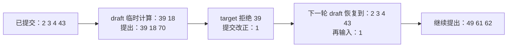

# 跟着一轮猜错的候选继续生成

[返回首页](../README.md) · [双模型实现与实验](MODEL_DRAFT.md) · [English](#english-walkthrough)

draft 提出三个候选，target 却只接受前面几个，两边下一轮该从哪里接上？这个例子直接打印输入、候选、提交结果和缓存进度，让你沿着同一轮读 [`ModelDraft`](../minideepinfer/model_draft.py) 与 [`generate`](../minideepinfer/speculative.py)。

## 先跑一次拒绝

在 v0.4.0 源码目录，按[运行指南](START_HERE.md)准备兼容 PyTorch 后执行：

```bash
python -m minideepinfer.model_draft_demo --cpu-example rejection --trace-rounds --width 3 --output outputs/draft-rejection.json
```

不需要权重、tokenizer 或 NPU。target 与 draft 都是未训练的 Qwen3.5 随机小模型，种子分别为 2026、2036。这个预设让输出头与输入嵌入不共享权重；候选仍来自 draft 实际预测，没有预先读取 target 答案，也没有手动改错候选。打印的整数是 token ID，不是自然语言。

### 第一轮：draft 猜了三个，target 一个也没接受

prompt 是 `[2, 3, 4]`，target 首次输出 `43`。这个 `43` 已经提交给读者，但 target 尚未把它作为下一次输入。draft 先计算完整的 `[2, 3, 4, 43]`，再提出三个候选：

```text
提出 [39, 18, 70]；draft 实际额外输入 [39, 18]。
target 输入 [43, 39, 18, 70]，预测 [1, 96, 51, 58]。
接受 0 个候选，提交 [1]（target 改正）。
```

target 对 `43` 的下一词预测是 `1`，不是 draft 的 `39`，所以后面的候选也不能提交。draft 为什么只输入 `39, 18`？因为算完 `18` 就能预测出 `70`，最后一个候选不必先送回 draft。

这一轮 target 暂时计算了七个输入，拒绝后只保留前四个：`[2, 3, 4, 43]`。完整注意力把后面的 KV 排除在有效范围外；线性层先恢复快照，再重算这轮保留的输入 `43`。刚提交的 `1` 仍待下一轮消费。

### 第二轮：draft 也要离开错误分支

此刻 draft 已计算的是 `[2, 3, 4, 43, 39, 18]`，实际提交的前缀却是 `[2, 3, 4, 43, 1]`。下一次请求候选时会打印：

```text
draft 已算 6 → 保留 4 → 补到 5；恢复线性状态=True，重算 0，补算 1 个输入。
提出 [49, 61, 62]；draft 实际额外输入 [49, 61]。
```

这里的 `6 → 4 → 5` 是逻辑输入数：先丢弃错误的 `39, 18`，恢复到已经保存的四输入状态，再计算真正提交的 `1`。恢复点本来就位于共同前缀末端，所以 draft 不需要重算已保留输入，只补算一个新输入。



这个种子下，宽度 3 的八个候选验证轮共提出 21 个候选，接受零个，AL 为 `8/8 = 1`。draft 实际恢复了七次旧分支；target 恢复后共重算八个输入。最后只剩一个输出时，候选上限变为零，draft 不再计算。两边最后归还全部 12 个槽位，线性状态和快照清空。

## 再看全部接受

```bash
python -m minideepinfer.model_draft_demo --trace-rounds --width 3 --output outputs/draft-repeat.json
```

默认随机模型共享输入嵌入与输出头，当前种子下会重复输出 `4`。宽度 3 接受 6/6，两个候选验证轮各提交四个输出，包含 bonus；draft 沿已有有效状态继续补算，不需要恢复错误分支。用它对照前一个例子，看清“接受更多”和“状态恢复更多”的区别。

两个例子都先用独立 target greedy 验证输出，再对照两边的冷缓存状态及末尾完整 logits。宽度 1 和 3 都检查，但 `--trace-rounds` 只记录所选宽度，不增加模型调用。观察开关前后，输出、缓存检查和工作量逐项相同。它显示主机读到的 token 列表与逻辑长度，没有设备时间戳；与 `--repeats` 计时分开运行。

## 换成 Ascend 910C 的真实权重

已有[配套环境与本地权重](START_HERE.md#ascend-910c真实权重)时，在源码目录执行：

```bash
ASCEND_RT_VISIBLE_DEVICES=0 OMP_NUM_THREADS=1 python -m minideepinfer.model_draft_demo \
  --draft-model weights/Qwen3.5-0.8B --target-model weights/Qwen3.5-2B \
  --device npu:0 --trace-rounds --width 3 --output outputs/draft-npu.json
```

这里不使用 `--cpu-example rejection`，模型按各自 checkpoint 配置加载。固定短输入的首轮实测为：

```text
提出 [13, 198, 760]；draft 实际额外输入 [13, 198]。
target 输入 [11751, 13, 198, 760]，预测 [13, 198, 32, 6511]。
接受 2 个候选，提交 [13, 198, 32]（target 改正）。
```

这次错误恰好在最后一个候选 `760`。它没有作为 draft 输入，所以 draft 自己不需要截短旧分支；下一轮只补算 target 改正的 `32`。target 已经消费了 `760`，仍要恢复自己的线性状态。不能因为 target 拒绝过候选，就声称两边都发生了回退。

本次 v0.4 验收的宽度 1/3 分别接受 4/5、6/7，AL 分别为 1.8、3.0；输出同独立 greedy，十六次冷缓存检查在原定 `atol=1e-4, rtol=2e-4` 下通过。两边各归还 14 个槽位。只做数值与状态验收，没有计时，也没有在 NPU 上注入异常。

[重复 CPU 输出](results/2026-10-25/model-draft-repeat-cpu.txt)、[拒绝 CPU 输出](results/2026-10-25/model-draft-rejection-cpu.txt)和[真实 NPU 输出](results/2026-10-25/qwen35-v04-rc.txt)逐行保留，对应 JSON 及十二份源码的 SHA 见[v0.4 索引](results/v0.4/evidence.json)。完整程序分别执行 44、109、50 次 forward，包含基线与冷参考；不能把这里的次数直接换算成加速倍数。

这条教学路径继续沿 DeepInfer 的验证、结果提交和后续长度修正理解状态分工，来源见[固定源码对应](SPECULATIVE.md#这和-deepinfer-怎样对应)。独立双模型和同步快照恢复是这里的简化实现，不是 DeepInfer MTP 或 SWA Bounded Replay。

## English walkthrough

With compatible CPU PyTorch, run `python -m minideepinfer.model_draft_demo --cpu-example rejection --trace-rounds --width 3 --output outputs/draft-rejection.json`. Both tiny Qwen3.5 models are untrained, with seeds 2026/2036 and untied embedding/output-head weights. Candidates come from actual draft predictions, without answer lookup or candidate injection.

After target prefill emits `43`, the draft consumes `[2,3,4,43]`, proposes `[39,18,70]`, and feeds back only `[39,18]`. The target predicts `1` for the first candidate position, rejects the branch, and commits `1`. The next draft call shows `6 → 4 → 5`: restore the four-input committed state, then consume the correction `1`. Width 3 accepts 0/21, with AL 1 and seven draft branch recoveries. This synthetic example explains state handling, not model quality or speed.

Omit `--cpu-example rejection` to see the repeat-token example accept 6/6 and produce bonus tokens. Both modes match independent greedy output and cold-cache state; observing rounds adds no model calls. Observations contain token IDs and logical lengths, not device timings, and cannot be combined with `--repeats`.

The real Qwen3.5-0.8B-to-2B Ascend 910C check accepted 4/5 and 6/7 at widths 1/3, passed sixteen cold-cache checks and returned all fourteen slots per model. In the first width-3 round, only the last candidate was wrong; it had not been fed into the draft, so only the target needed state recovery. Draft truncation is demonstrated by the CPU rejection case. The release check loaded each existing checkpoint once, made fifty model calls, and measured no latency or speedup.
